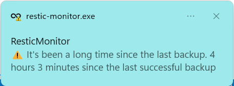
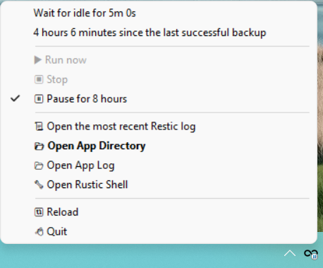

# restic-monitor

## Overview

ResticMonitor is a tray application for Windows that can start a [restic](https://restic.net/) backup when the user is idle.

## Features

* Run backup when the user's been idle for more than N seconds (configurable).
* Show warning when the computer hasn't been back up for more than N seconds (configurable).


*  Minimum time between two backups (configurable).

* Pause for 8 hours not to be interrupted by backup. This is persisted across restarts (configurable).


* Open Restic Shell: an interactive cmd with the configured restic environment variables applied and the restic executable on PATH, for troubleshooting and restores.

* Multiple backup targets (e.g. windows plus WSL) run sequentially, with per-target status in the tray menu.

* Per-target run logs, pruned automatically after a configurable retention period.

## Installation

1. Download and extract the application distribution zip file.
2. Run `install.cmd` from the extracted folder (or `Install.ps1` directly). This script will automatically set up the application in `%LOCALAPPDATA%\restic-monitor`, download the latest restic release from GitHub into `%LOCALAPPDATA%\restic-monitor\bin` (SHA256-verified), configure a scheduled task with highest privileges, and create default configuration files.

To uninstall, use Windows "Apps & Features" (restic-monitor) or run `Uninstall.ps1` from the install directory. Your `settings.json` and `env.json` are preserved for future reinstalls.

### Configuration

The configuration files for the app live in `%LOCALAPPDATA%\restic-monitor`. Find examples in [example_configs](/example_configs) directory.

After changing the config, click "reload" in the menu to restart the app.

**env.json**

env.json should contain the environment variables for the restic backup job. See the supported environment variables in [the doc](https://restic.readthedocs.io/en/latest/030_preparing_a_new_repo.html). Example:

```json
{
    "RESTIC_REPOSITORY": "s3:s3.amazonaws.com/bucket_name",
    "AWS_ACCESS_KEY_ID": "",
    "AWS_SECRET_ACCESS_KEY": ""
}
```

**settings.json**

`settings.json` defines the settings for the program.

1. `restic_exe`: optional location of the restic executable. When omitted, the app uses the copy the installer provisioned at `%LOCALAPPDATA%\restic-monitor\bin\restic.exe`.
2. `args`: is an array of Strings to run the backup job.
3. `min_idle_seconds`: Minimum idle seconds before automatically running the backup. Idle seconds is defined by the seconds elapsed since the last user interaction (e.g., a keystroke or mouse movement).
4. `min_seconds_between_backups`: Minimum time between two consecutive backups.
5. `no_backup_warning_seconds`: How many seconds since the last successful backup. Successful backup is defined as when restic executable returned the exit code 0.
6. `ignore_exit_code_3`: Treat exit code 3 as success (`true` or `false`). If you don't really care about files not being backed up due to permissions issue, this can simplify the set up a lot.
7. `restic_log_retention_days`: How many days to keep per-run backup logs (default 180). Each target's run logs live under `logs/<target>/`.
8. `extra_backups`: Optional map of additional backup targets. Each entry supports `exe`, `args`, optional `env` (merged over `env.json`), optional `ignore_exit_code_3`, optional `restic_log_retention_days`. Targets run sequentially after the primary backup; each target has its own success marker and logs.

Example:

```json
{
    "args": [
        "backup",
        "-v",
        "--use-fs-snapshot",
        "--iexclude-file=C:\\Users\\myuser\\OneDrive\\restic-exclude.txt",
        "C:\\",
        "C:\\Program Files (x86)\\Battle.net",
        "C:\\Program Files (x86)\\Origin Games",
        "C:\\Program Files (x86)\\Steam",
        "C:\\Program Files (x86)\\Ubisoft"
    ],
    "min_idle_seconds": 300,
    "min_seconds_between_backups": 900,
    "no_backup_warning_seconds": 3600,
    "ignore_exit_code_3": false,
    "restic_log_retention_days": 7,
    "extra_backups": {
        "wsl": {
            "exe": "wsl",
            "args": [
                "-d", "Ubuntu-24.04", "-u", "root", "--",
                "bash", "-lc",
                "source /usr/local/bin/restic-env && restic backup / -v --one-file-system --tag wsl"
            ],
            "env": {},
            "ignore_exit_code_3": true
        }
    }
}
```

The full-featured example lives in [example_configs](/example_configs).


## Troubleshooting

Logs live under `%LOCALAPPDATA%\restic-monitor\logs` and the directory opens via the tray menu ("Open App Directory").

1. `restic-monitor.log` (plus hourly `restic-monitor.log.*` rotations): the application log.
2. `<target>/<target>-<timestamp>.log`: output of each restic invocation, one file per run, pruned after `restic_log_retention_days`.

## Tips

### Backing up User-writable directory

Usually you don't need to backup the directories like `Program Files` because they can be easily downloaded from the Internet. However, some applications (gaming software such as Steam) likes to put user saves in those directories. An easy way to list these directories to find all user-writable directories by running `accesschk -uwds Users "C:\Program Files (x86)"` (get [accesschk here](https://learn.microsoft.com/en-us/sysinternals/downloads/accesschk)). 

Then you configure `Program Files` as part of your exclude file, and then re-add the user-writable subdirectories (e.g., `Program Files (x86)\Steam`) as another "root" of the backup.

### Return code 3

Return code 3 indicates that there were files that were not backup-able. 

1. If it's a onedrive placeholder file, check "Always keep on device"
2. If it's a file that cannot be backed up, then add this to your exclude list.
3. If you don't care, set ignore_exit_code_3 to `true`.

## Reference

### Other files

1. `lock`: prevents two instances from running at the same time.
2. `pause_until.txt`: stores the pause until time.
3. `<target>-last-successful.marker`: its modification time is the last successful run of that target (e.g. `windows-last-successful.marker`). The tray reads these at startup, so status survives restarts.
4. `bin`: the restic executable provisioned by the installer.
5. `app`: the application itself.
6. `logs`: contains the log files.
   1. `restic-monitor.log`, `restic-monitor.log.*`: application log (hourly rotation, capped)
   2. `<target>/<target>-<timestamp>.log`: one log per restic run, pruned by `restic_log_retention_days`

### How is the idle time calculated?

[GetLastInputInfo](https://learn.microsoft.com/en-us/windows/win32/api/winuser/nf-winuser-getlastinputinfo) is used to calculate the idle time.

## Development

For information on running and building the application, see [DEVELOPMENT.md](./DEVELOPMENT.md).

## Attribution

* main.ico from [ionicons](https://github.com/ionic-team/ionicons).